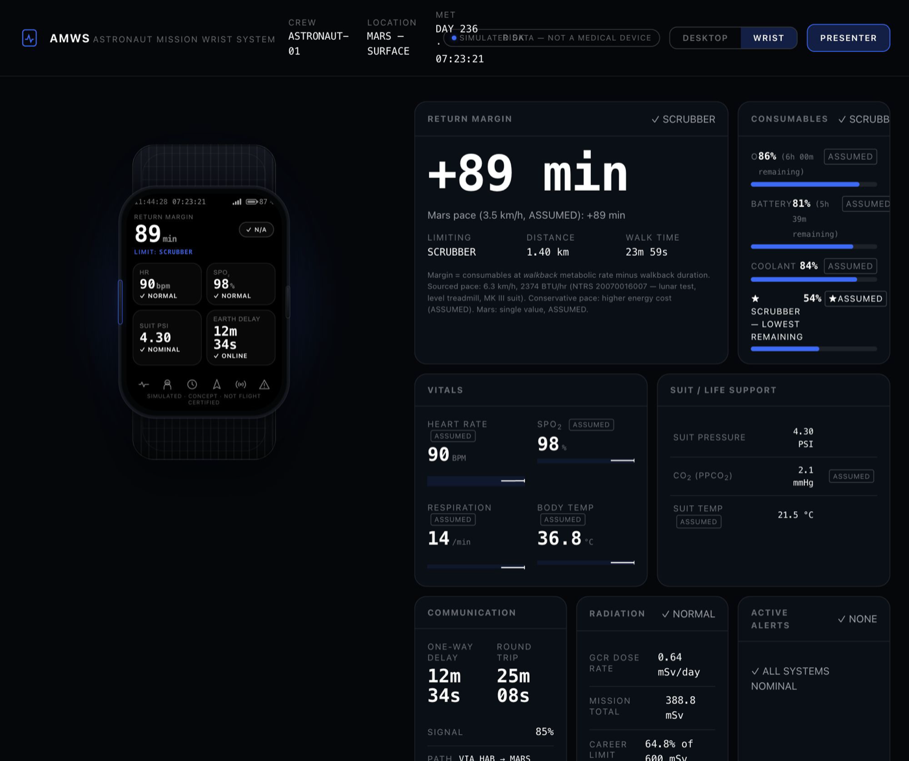

# AMWS — Astronaut Mission Wrist System

**Live demo:** https://amws.vercel.app

Concept prototype of a wrist-mounted mission computer for crews on the Moon, Mars, and beyond. All data is **simulated in the browser**. Not a medical device or flight system.

Built for the **2024 NASA International Space Apps Challenge** — *"Wearable Technology for Astronaut Health and Safety"* track.

**Team:** AMWS · **Members:** Naël David

---

## Screenshots

| Desktop / Ground view | Wrist computer |
|---|---|
|  |  |

> Screenshots at `assets/screenshots/`. Run `python3 -m http.server 8080` and open the site to capture them.

---

## Run it

Open `index.html` directly in Chrome/Edge/Safari — no install, no build step, no internet.

Or serve it locally:

```
python3 -m http.server 8080
```

Then open `http://localhost:8080`. Add `?view=wrist` to start in wrist mode.

---

## What it does

**Wrist computer** — physical-looking unit with bezel keys (HOME, BACK, ACK, guarded EMER hold 1.5 s).

Watch screens: Home · Vitals · Suit · Mission · Nav · Comms (+ message composer) · Alerts · Emergency (+ Contact Earth, Life Support checklist, Return to Hab, Medical Data).

**Ground / Flight Controller view** — tiles updated at 4 Hz:

| Tile | Crew decision it supports |
|---|---|
| Return Margin (hero) | Can I get back to the hab? How much buffer do I have? |
| Consumables (4 bars) | Which resource runs out first? |
| Vitals + sparklines | Is the crew member trending toward a threshold? |
| Comms | How long until Earth can respond? Is the link up? |
| Radiation | Am I approaching career limit? Is an SPE in progress? |
| Active Alerts | What needs action right now, in priority order? |
| Event Log | What happened and when? |

**Presenter Tool** (drawer, top-right) — demo start/pause/reset, scenario selectors, SPE stage, comm mode, time acceleration, auto-emergency toggle, TRIGGER EMERGENCY. Not part of the crew UI.

**Keyboard:** `H` = home, `Backspace` = back, `Esc` = close drawer.

---

## Data honesty

Every number in this simulation is either traced to a primary NASA source or explicitly tagged **ASSUMED** in the UI and in `config.js`. Values labeled **ILLUSTRATIVE** are historical reference scenarios (e.g. the Aug 1972 SPE doses) — real data, but not predictive of future events. If you see neither label, the value is sourced; see the table below or [docs/DATA_SOURCES.md](docs/DATA_SOURCES.md) for the full citation.

### Sourced values
- Walkback test pace **6.3 km/h at 2374 BTU/hr** — NTRS 20070016007 (Vos, Gernhardt, Lee 2007), 10 km lunar-gravity treadmill offload, MK III suit. Subjects were cooling-limited at this pace.
- EMU 7-hour consumables baseline — CCTV 2008 EMU specs (MEDIUM confidence). 30-min emergency reserve from same source anchors the WARNING margin threshold.
- CO₂ 15 mmHg inspired limit — NASA Tech Bulletin 02182025; Nature s41526-026-00589-x.
- CO₂ cabin SMAC limits: 10 mmHg (24-hour), 5.3 mmHg (7–180 day) — NTRS 20150021777.
- Metabolic baseline 1000 BTU/hr (Apollo EVA average), peak ≤ 2200 BTU/hr — Gernhardt 2013 (EVA Ops Ch. 5.4).
- Suit pressure 4.3 psig nominal — NTRS 20070016007; NTRS 20230008644 (xEMU).
- Radiation dose rates: ISS 0.42 mSv/day (NIH PMC 18582161); Mars surface 0.64 mSv/day (MSL/RAD, Hassler 2014 Science); deep-space cruise 1.84 mSv/day (MSL/RAD, Guo 2014); lunar surface ~1.4 mSv/day (Chang'e-4 LND + Apollo-era, MEDIUM confidence).
- Career limit 600 mSv — NASA-STD-3001 Vol 1 Rev B.
- Communication delays — astronomical constants + NASA mars-communications PDF.

### ASSUMPTION items
- All vital sign thresholds (HR, SpO₂, temperature, respiration) — clinical standards adapted for EVA context; no NASA public flight-rule source.
- CO₂ caution/warning bands (5/10 mmHg) — intermediate bands only; 15 mmHg limit is sourced.
- Conservative walkback pace (4.0 km/h, 1800 BTU/hr) — higher energy cost than test pace; no sourced data.
- Mars walkback pace (3.5 km/h, 2000 BTU/hr) — no Mars 10 km walkback test data exists.
- Consumable alert bands (%, all resources) — mirror O₂ band rationale; no sourced thresholds.
- Career dose caution/warning bands (400/500 mSv) — design choice; no NASA public threshold.
- SPE 4-stage alert progression — design choice (SPEC.md Part 4).
- EVA planned duration and elapsed alert fractions — illustrative defaults.

See [docs/DATA_SOURCES.md](docs/DATA_SOURCES.md) and [docs/SPEC.md](docs/SPEC.md) for full citations.

---

## Sources

Key NASA documents cited in this prototype:

| ID | Title / Description |
|---|---|
| [NTRS 20070016007](https://ntrs.nasa.gov/citations/20070016007) | Vos, Gernhardt, Lee — Walkback Test (10 km lunar, MK III suit, 6.3 km/h, 2374 BTU/hr) |
| [NTRS 20040100724](https://ntrs.nasa.gov/citations/20040100724) | Aug 1972 SPE — BFO doses in spacesuit vs shelter |
| [NTRS 20060010503](https://ntrs.nasa.gov/citations/20060010503) | Aug 1972 SPE — bone marrow dose, peak dose rate |
| [NASA-STD-3001 Vol 1 Rev B](https://www.nasa.gov/wp-content/uploads/2023/03/radiation-protection-technical-brief-ochmo.pdf) | Career radiation limit 600 mSv |
| [NTRS 20150021777](https://ntrs.nasa.gov/citations/20150021777) | Cabin CO₂ SMAC limits (10 mmHg / 5.3 mmHg) |
| [NTRS 20230008644](https://ntrs.nasa.gov/citations/20230008644) | xEMU variable pressure 4.3–8.2 psi |
| [Gernhardt 2013](https://nasa.gov/wp-content/uploads/2023/03/gernhardt-eva-ops-chp-5.4-2013.pdf) | Apollo EVA metabolic rates (1000 BTU/hr avg, 2200 peak) |

---

## Demo script (~60 s)

1. Open `index.html`. Click **PRESENTER** (top right) → **▶ START**.
2. Watch the wrist unit and Ground view. After ~8 s metabolic rate rises.
3. ~20 s: CO₂ begins climbing, SpO₂ falls. Return margin tightens.
4. ~32 s: battery drains fast — BATTERY becomes the limiting resource.
5. ~42 s: slow suit pressure decay begins.
6. ~54 s: pressure crosses 3.5 psi + CO₂ approaches limit → **auto-EMERGENCY** fires (~55–62 s).
7. On the wrist: try **Contact Earth**, **Life Support checklist**, **Return to Hab**.
8. Click **⟳ RESET** to restore nominal state.

---

## Tests

```
npm test
```

Runs: `boot-smoke` (boot + 200-tick smoke, no NaN/Infinity) · `check-config` (source tags on all constants) · `sim-check` (return margin math) · `assess-check` (classification logic) · `demo-check` (full 62 s demo, no NaN, valid triggers) · `check-cuts` (no cut features in owned files).

Additional static checks (not in `npm test`):

```
node tools/check-dom-safety.js
node tools/check-ui-boundary.js
```

`check-dom-safety` — fails if any UI file uses `innerHTML`/`outerHTML`/`insertAdjacentHTML` from a non-literal string. `check-ui-boundary` — fails if UI files access `A.state`, sim internals, or `A.LIMITS` directly.

---

## Known limitations

- No NOAA S-scale SPE stages (illustrative 4-stage progression only).
- No turnaround distance or time-to-threshold calculation.
- No conjunction countdown.
- No record/replay/export.
- No DONKI live panel.
- No LOLA elevation data (navigation is a random walk).
- Walkback pace data is from a 2007 lunar-gravity treadmill test (MK III suit, level surface). Actual EVA surface conditions, suit generation, and crew fitness will differ.
- The cardiac waveform on the wrist Medical Data screen is a synthetic PQRST shape — not diagnostic.

---

## Future work

NOAA S-scale SPE stages · turnaround distance · time-to-threshold · conjunction countdown · DONKI live panel · LOLA elevation data · BroadcastChannel multi-window sync.

---

## Disclaimer

AMWS is a **design concept / prototype**. Not a certified medical device or flight system. Not approved by NASA, ESA, or any space agency. All readings are generated by a local simulation. Thresholds and procedures are simplified illustrations. Emergency checklists are **ILLUSTRATIVE** — not NASA-certified flight procedures.
